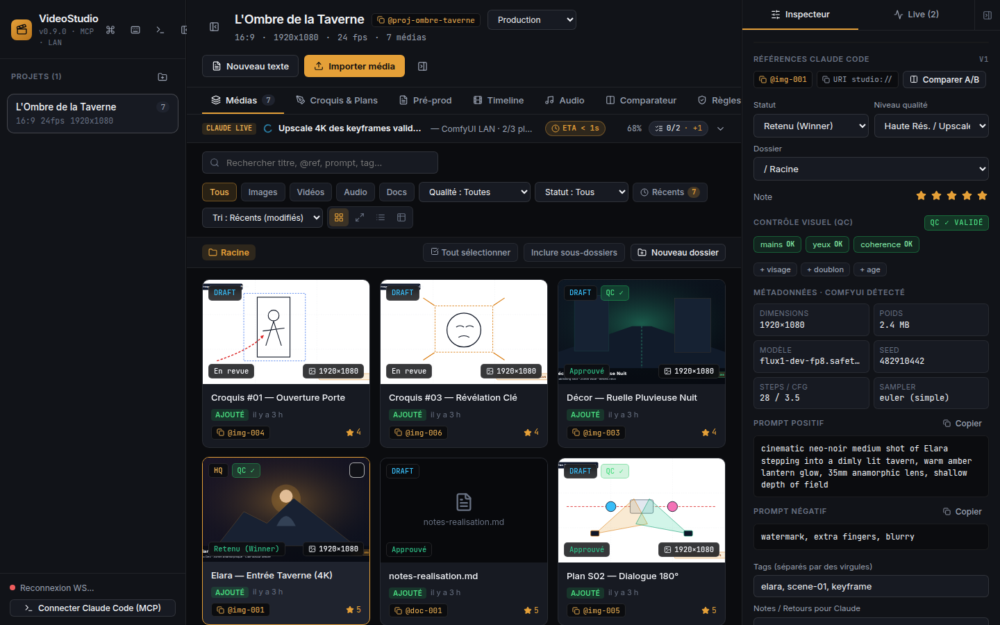
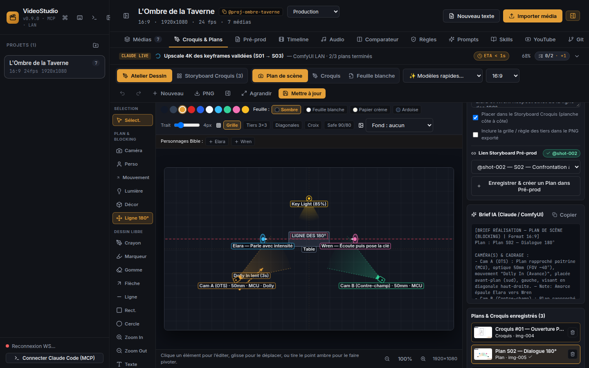
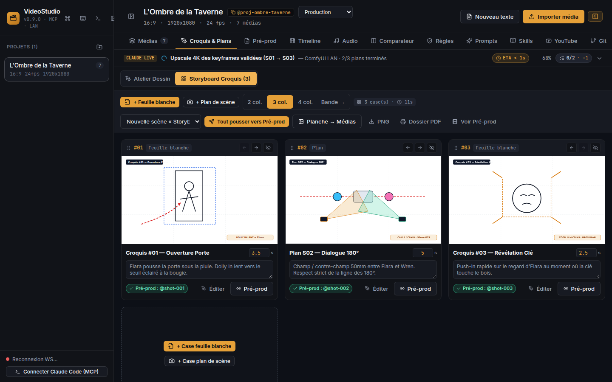
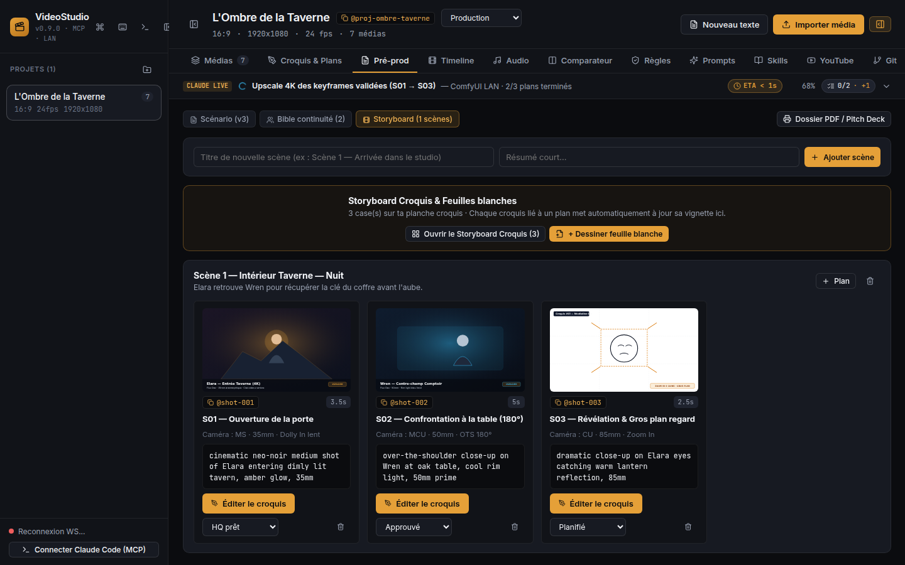
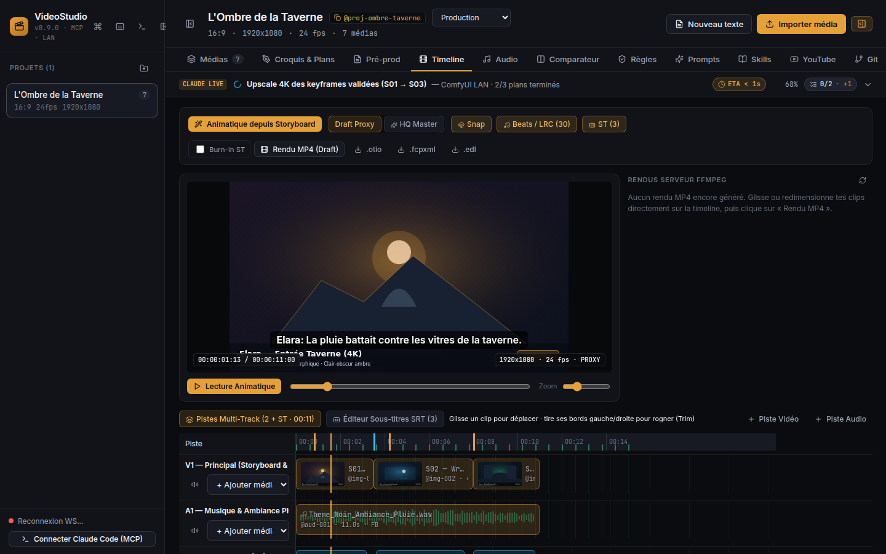
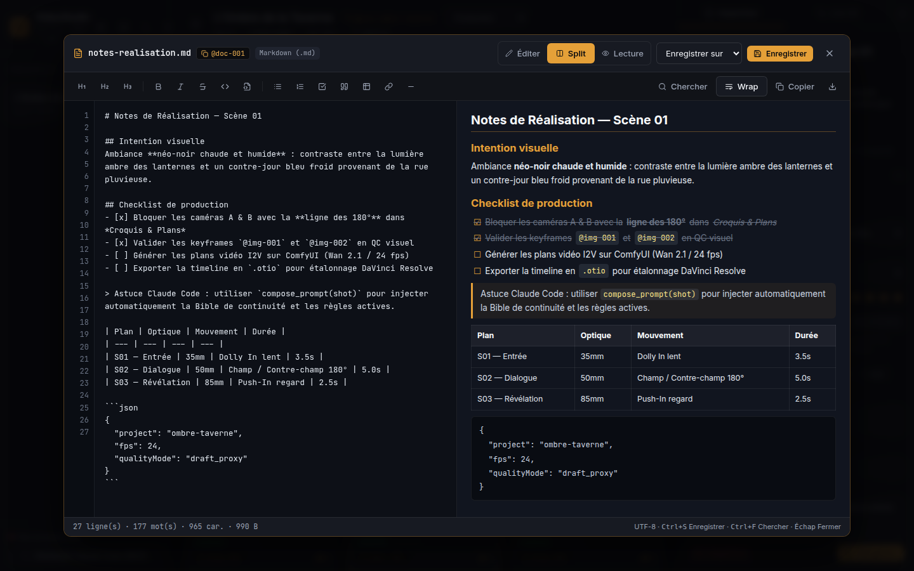

# VideoStudio — Studio Vidéo Assisté par IA & Claude Code

[](#)
[](#architecture)
[](#mises-à-jour-sans-interruption-bluegreen)

**VideoStudio** est un studio de production vidéo auto-hébergé sur serveur local (Linux / Debian + Docker Compose), conçu pour collaborer en temps réel avec **Claude Code** via **MCP (Model Context Protocol)** et **ComfyUI** — de la conception (scénario, bible, croquis à main levée, plans de scène, storyboard) jusqu'au montage multi-pistes NLE et à la publication YouTube.



---

## Sommaire

- [Aperçu des fonctionnalités](#-aperçu-des-fonctionnalités)
- [Architecture](#architecture)
- [Installation rapide (Debian / Linux + Docker)](#-installation-rapide-debian--linux--docker)
  - [1. Prérequis](#1-prérequis)
  - [2. Clonage & configuration sécurisée](#2-clonage--configuration-sécurisée)
  - [3. Démarrage de la stack Docker](#3-démarrage-de-la-stack-docker)
  - [4. Connexion de Claude Code (MCP)](#4-connexion-de-claude-code-mcp)
  - [5. Variables d'environnement (.env)](#5-variables-denvironnement-env)
  - [6. Ingestion ComfyUI (LAN ou zéro-copie)](#6-ingestion-comfyui-lan-ou-zéro-copie)
- [Guide d'utilisation](#-guide-dutilisation)
  - [Médias, dossiers, multi-sélection & Récents](#1-médias-dossiers-multi-sélection--récents)
  - [Atelier Croquis & Plans de Scène](#2-atelier-croquis--plans-de-scène)
  - [Storyboard Croquis & Feuille blanche](#3-storyboard-croquis--feuille-blanche)
  - [Pré-production : Scénario, Bible & Storyboard](#4-pré-production--scénario-bible--storyboard)
  - [Timeline multi-pistes & Exports NLE](#5-timeline-multi-pistes--exports-nle)
  - [Éditeur enrichi de fichiers texte (.md, .txt, .log…)](#6-éditeur-enrichi-de-fichiers-texte-md-txt-log)
  - [Audio (Suno / LRC), Comparateur A/B, Règles, YouTube & Ops](#7-audio-suno--lrc-comparateur-ab-règles-youtube--ops)
  - [Raccourcis clavier Pro](#8-raccourcis-clavier-pro)
- [Catalogue des outils MCP (Claude Code)](#-catalogue-des-outils-mcp-claude-code)
- [Mises à jour sans interruption (Blue/Green)](#mises-à-jour-sans-interruption-bluegreen)
- [Sécurité & Dépôt public](#-sécurité--dépôt-public)
- [Développement local](#-développement-local)

---

## ✨ Aperçu des fonctionnalités

| Module | Capacités principales |
| --- | --- |
| **Médias & DAM** | Arborescence de dossiers & sous-dossiers, **glisser-déposer simple ou multi-sélection** (`Ctrl/Cmd+Clic`, `Shift+Clic`), vues **Grille / Grandes miniatures / Liste / Détails**, filtre **Récents**, extraction automatique des métadonnées **ComfyUI** (prompts, seed, CFG, LoRAs, workflow JSON), références `@ref` & `studio://`, lignage de versions (`v1 → v2`), panneaux latéraux redimensionnables & masquables. |
| **Croquis & Plans de Scène** | **Plan de scène (Blocking vue du dessus)** : caméras avec cône FOV par focale (`24–135mm`), personnages liés à la Bible, lumières (`Key/Fill/Rim/Practical`), décors, trajectoires & ligne des 180°, **Brief IA auto-généré**. **Mode Croquis / Feuille blanche** : dessin main levée, guides cinéma, underlay image, ouverture **plein cadre**, zoom fluide (`35%–300%` + `Ctrl+Molette`) et mode **Plein écran (`F`)**. |
| **Storyboard Croquis & Pré-prod** | Planche côte à côte (`2/3/4 colonnes` ou bande horizontale), réordonnancement Drag & Drop, export planche PNG, **liaison bidirectionnelle** avec le **Storyboard Pré-prod** (Scénario, Bible, Découpage technique) et **Export Dossier de Production PDF / Pitch Deck** en 1 clic. |
| **Éditeur texte enrichi** | Lecture et édition in-app de `.md`, `.txt`, `.log`, `.json`, `.yaml`, `.srt`, `.lrc`, `.fountain`, etc. Mode **Split** (Markdown + aperçu enrichi), colorisation de logs par niveau (`ERROR`/`WARN`/`INFO`), formatage JSON, `Ctrl+F` Rechercher/Remplacer et versionnage `v1 → v2`. |
| **Timeline NLE v2 & Sous-titres** | Montage multi-pistes avec **Drag & Trim direct**, aimantation **Snap**, **waveforms audio**, marqueurs **BPM & paroles Suno/LRC**, aperçu live des transitions (`Crossfade` / `Fondu au noir`), **piste Sous-titres SRT/VTT** avec incrustation live + **Burn-in FFmpeg**, bascule **Draft ↔ HQ** et exports **OTIO / FCPXML / EDL**. |
| **Collaboration Claude Code (MCP)** | **81 outils MCP** (`Streamable HTTP`), suivi en direct des tâches & **ETA temps réel** par WebSocket, file d'attente de retours horodatés sur frames vidéo, règles de studio hiérarchiques, bibliothèque de prompts/workflows & synchronisation `SKILL.md`. |
| **Publication & Exploitation** | Préparation **YouTube Ready Pack** (miniatures, chapitres, titres, description) + upload brouillon OAuth2 optionnel, **Watch Folders ComfyUI**, webhooks HMAC, monitoring disque/nettoyage, backups automatiques & déploiement **Blue/Green zéro coupure**. |

---

## Architecture

```text
                      ┌─────────────────────────────────────────┐
  Navigateur LAN ────▶│  Nginx Gateway (port STUDIO_PORT=3100)  │◀──── Claude Code (MCP HTTP)
                      │  UI React · API REST · WebSocket · /mcp │
                      └───────────────┬───────────────┬─────────┘
                                      │               │  (Bascule atomique Blue ↔ Green)
                            ┌─────────▼───┐     ┌─────▼────────┐
                            │  app-blue   │     │  app-green   │  Fastify + Sharp + FFmpeg
                            └─────┬───────┘     └──────┬───────┘
                                  └─────────┬──────────┘
                                            │ Réseau interne Docker (videostudio-internal)
                                  ┌─────────▼──────────┐
                                  │   PostgreSQL 16    │  (jamais exposé sur le LAN)
                                  └────────────────────┘
```

- **PostgreSQL 16** est strictement confiné au réseau Docker interne (`videostudio-internal`) et n'expose aucun port sur l'hôte.
- Les médias gérés, vignettes WebP, proxies web, sauvegardes et skills sont persistés dans `./data`, `./backups` et `./skills`.
- Les dossiers ComfyUI peuvent être montés en **lecture seule** (`INGEST_HOST_DIR`, `INGEST_EXTRA_DIRS`) pour une ingestion **zéro-copie** (`storageMode: "reference"`).

---

## 🚀 Installation rapide (Debian / Linux + Docker)

### 1. Prérequis

- Serveur Linux (Debian 12/13, Ubuntu 22.04/24.04 ou équivalent) accessible sur votre réseau local (LAN)
- **Docker Engine** et **Docker Compose v2** (`docker compose version`)
- `git`, `openssl` et `curl`

### 2. Clonage & configuration sécurisée

```bash
git clone https://github.com/Aquadrox/VideoStudio.git
cd VideoStudio
./scripts/init-env.sh
```

Le script `./scripts/init-env.sh` crée votre fichier `.env` local (permissions `600`, ignoré par Git) avec :
- un mot de passe `POSTGRES_PASSWORD` généré aléatoirement,
- un jeton `MCP_AUTH_TOKEN` de 64 caractères hexadécimaux pour sécuriser l'accès MCP de Claude Code,
- les dossiers locaux `./data`, `./ingest`, `./skills` et `./backups`.

### 3. Démarrage de la stack Docker

```bash
docker compose up -d --build
```

Vérifiez que tout est opérationnel :

```bash
curl -s http://localhost:3100/api/health
```

Ouvrez ensuite l'interface depuis n'importe quel poste ou tablette de votre réseau local :

```text
http://<IP-DE-VOTRE-SERVEUR>:3100
```

*(Remplacez `3100` si vous avez personnalisé `STUDIO_PORT` dans `.env`.)*

### 4. Connexion de Claude Code (MCP)

Sur la machine où tourne **Claude Code** (sur le serveur lui-même ou sur un poste du LAN) :

```bash
claude mcp add --transport http videostudio http://localhost:3100/mcp \
  --header "Authorization: Bearer $(grep '^MCP_AUTH_TOKEN=' .env | cut -d= -f2)"
```

Si Claude Code s'exécute sur une autre machine du LAN, remplacez `localhost` par `http://<IP-DE-VOTRE-SERVEUR>:3100/mcp` et passez la valeur de `MCP_AUTH_TOKEN` issue du `.env` du serveur.

Vérifiez la connexion dans Claude Code avec `/mcp` : le serveur **`videostudio`** doit apparaître comme connecté avec ses outils et ressources `studio://`.

### 5. Variables d'environnement (`.env`)

Consultez [`.env.example`](.env.example) pour la liste complète. Principales variables :

| Variable | Défaut | Description |
| --- | --- | --- |
| `STUDIO_PORT` | `3100` | Port HTTP exposé par la passerelle Nginx sur votre serveur LAN. |
| `POSTGRES_PASSWORD` | *(généré)* | Mot de passe PostgreSQL interne (ne jamais commiter). |
| `MCP_AUTH_TOKEN` | *(généré)* | Jeton Bearer requis pour les appels `/mcp` de Claude Code. |
| `MAX_UPLOAD_MB` | `2048` | Taille maximale d'un fichier uploadé via l'interface (en Mo). |
| `ALLOWED_FETCH_HOSTS` | *(vide)* | Liste d'hôtes LAN autorisés pour l'ingestion d'URL (ex. `<IP-PC-COMFYUI>:8188`). Vide = LAN privé RFC1918/localhost autorisé. |
| `INGEST_HOST_DIR` | `./ingest` | Dossier hôte monté en lecture seule sur `/ingest` (ex. dossier `output/` de ComfyUI). |
| `INGEST_EXTRA_DIRS` | *(vide)* | Racines supplémentaires montées en lecture seule via `docker-compose.override.yml`. |
| `COMFYUI_BASE_URL` | *(vide)* | URL de votre serveur ComfyUI (ex. `http://<IP-PC-COMFYUI>:8188`) pour le suivi automatique des jobs. |
| `YOUTUBE_CLIENT_ID` / `SECRET` / `REFRESH_TOKEN` | *(vide)* | Optionnel — active l'upload direct en brouillon vers YouTube Data API v3. |

### 6. Ingestion ComfyUI (LAN ou zéro-copie)

Deux méthodes simples pour faire entrer les rendus ComfyUI dans VideoStudio :

1. **Par URL LAN ComfyUI** : Claude Code appelle `register_asset` avec une URL `http://<IP-COMFYUI>:8188/view?filename=...`. VideoStudio télécharge le fichier, extrait automatiquement le prompt, le modèle, les LoRAs, le seed et le graphe JSON, puis génère vignette et proxy.
2. **Par dossier monté zéro-copie (recommandé pour les gros rushs)** : pointez `INGEST_HOST_DIR` dans `.env` vers votre répertoire `ComfyUI/output` (ou créez un `docker-compose.override.yml` non suivi par Git pour plusieurs montages via `INGEST_EXTRA_DIRS`).
   - En appelant `register_asset(..., storageMode: "reference")` ou en configurant un **Watch Folder** dans l'onglet **Exploitation**, VideoStudio référence l'original sur disque **sans le dupliquer** dans `./data/originals/` et ne touche jamais aux fichiers sources lors d'une suppression.

---

## 🎬 Guide d'utilisation

### 1. Médias, dossiers, multi-sélection & Récents

L'onglet **Médias** centralise images, rushs vidéo, pistes audio, plans de scène, croquis et documents texte :

- **Organisation par dossiers** : créez des dossiers et sous-dossiers (`/plans`, `/croquis`, `/personnages`, `/rushs`, `/scripts`, …) dans la colonne de gauche.
- **Glisser-déposer & multi-sélection** : sélectionnez un ou plusieurs médias (`Ctrl/Cmd+Clic`, `Shift+Clic` pour une plage, `Ctrl/Cmd+A` pour tout sélectionner) puis glissez-les directement dans un dossier de la barre latérale ou utilisez la barre d'actions groupées (**Déplacer**, **Statut**, **Supprimer**).
- **Modes d'affichage & Récents** : basculez instantanément entre **Grille**, **Grandes miniatures**, **Liste** et **Détails**, ou cliquez sur **Récents** pour visualiser immédiatement les derniers ajouts et modifications du projet (y compris ceux poussés par Claude Code).
- **Inspecteur & Panneaux modulaires** : redimensionnez les colonnes gauche et droite par poignée de glissement, ou masquez/réaffichez-les en 1 clic pour maximiser l'espace de travail.
- **Références `@ref` pour Claude Code** : cliquez sur `@img-001` ou `Copier @ref` pour citer précisément un média dans vos instructions à Claude Code.

---

### 2. Atelier Croquis & Plans de Scène



L'onglet **Croquis & Plans** réunit deux modes complémentaires :

- **Mode Plan de scène (Blocking — vue du dessus)** :
  - Placez vos **Caméras** avec visualisation en temps réel du **cône de champ (FOV)** selon la focale (`24mm`, `35mm`, `50mm`, `85mm`, `135mm`), la valeur de plan (`EWS` à `INSERT`) et le mouvement (`Dolly In`, `Orbite`, `Travelling`, `Pan`, `Tilt`, `Grue`, `Handheld`).
  - Importez vos **Personnages** en 1 clic depuis la **Bible de continuité** avec pose, action et direction du regard.
  - Ajoutez des **Lumières** (`Key`, `Fill`, `Rim`, `Practical`), des **Décors / Accessoires** (`Mur`, `Table`, `Porte`, `Fenêtre`, `Repère X`, `Zone`, `Véhicule`), des **trajectoires de mouvement** droites ou courbes et la **ligne des 180°**.
  - Générez automatiquement un **Brief IA de réalisation** structuré, prêt à être copié ou lu directement par Claude Code via MCP (`get_sketch`).
- **Mode Croquis Storyboard (vue cadre)** :
  - Dessinez au **Crayon/Pinceau** lissé, **Marqueur**, **Gomme**, **Flèches**, **Formes**, cadres **Zoom In / Zoom Out** aux 4 coins et **Annotations texte**, avec guides cinéma (`Grille`, `Règle des tiers`, `Diagonales`, `Safe Frames`).
  - Superposez un **Underlay (image de fond)** issu de votre médiathèque pour dessiner ou corriger un cadrage directement par-dessus une image existante.
- **Confort de dessin plein cadre, Zoom & Plein écran** :
  - Le canvas s'ouvre automatiquement en **plein cadre** (adapté à 100 % de la zone disponible selon le ratio du projet).
  - Zoomez/dézoomez facilement de `35%` à `300%` via les boutons **`-` / `100%` / `+`**, les touches `+` / `-` / `0`, ou **`Ctrl/Cmd + Molette`**.
  - Cliquez sur **Agrandir** (ou appuyez sur **`F`**) pour passer l'atelier en **plein écran**, et masquez l'inspecteur droit de l'atelier en 1 clic pour profiter d'une surface de dessin maximale.
- **Stockage & ré-édition** : chaque plan ou croquis est sauvegardé en PNG haute définition dans **Médias** (avec versionnage `v1 → v2`) tout en conservant sa scène vectorielle éditable à tout moment.

---

### 3. Storyboard Croquis & Feuille blanche



- **Feuille blanche en 1 clic** : cliquez sur **Feuille blanche** pour démarrer instantanément un croquis à main levée sur papier blanc (ou choisissez parmi `Sombre`, `Feuille blanche`, `Papier crème`, `Ardoise`) avec adaptation automatique du contraste des guides.
- **Planche Storyboard côte à côte** : passez sur la vue **Storyboard Croquis** pour visualiser tous vos croquis et plans les uns à côté des autres (`2 / 3 / 4 colonnes` ou **bande horizontale**), les réordonner par **Drag & Drop**, éditer la **légende d'action** et la **durée (en secondes)** sous chaque case.
- **Export planche PNG & Liaison Pré-prod** : exportez toute la planche en une seule image PNG (téléchargement local ou enregistrement dans `/storyboard`), et synchronisez vos croquis vers le **Storyboard Pré-prod** en 1 clic (**Tout pousser vers Pré-prod**) : chaque modification ultérieure d'un croquis met automatiquement à jour la vignette du plan lié.

---

### 4. Pré-production : Scénario, Bible & Storyboard



L'onglet **Pré-prod** regroupe toute la préparation créative du film :

- **Scénario** : éditeur Markdown/Fountain avec historique de versions.
- **Bible de continuité** : fiches de **Personnages**, **Lieux**, **Accessoires** et **Styles visuels** avec mots-clés de prompt réutilisables et images de référence.
- **Storyboard & Découpage technique** : organisez vos scènes et plans (`S01-P01`, `S01-P02`…), liez un croquis existant ou cliquez sur **Dessiner un croquis** pour ouvrir une feuille blanche pré-liée au plan, puis utilisez le **Compositeur de prompt** qui assemble automatiquement la Bible, les règles actives du studio et le descriptif du plan.

---

### 5. Timeline multi-pistes & Exports NLE



- **Montage multi-pistes** : pistes **Vidéo**, **Voix off**, **Musique**, **SFX** et **Sous-titres**, génération automatique d'une **Animatique** depuis le Storyboard en 1 clic.
- **Workflow Draft ↔ HQ Upscale** : montez rapidement avec des rushs brouillons légers, puis basculez toute la timeline vers les versions **HQ Upscale** en un clic dès qu'elles sont prêtes.
- **Rendu & Exports professionnels** : lancez un rendu MP4 directement via FFmpeg ou exportez votre montage vers DaVinci Resolve, Premiere Pro ou Final Cut en **OpenTimelineIO (`.otio`)**, **Final Cut Pro XML (`.fcpxml`)** ou **CMX 3600 (`.edl`)**.

---

### 6. Éditeur enrichi de fichiers texte (`.md`, `.txt`, `.log`…)



- **Création & édition directe** : cliquez sur **Nouveau texte** dans Médias (ou double-cliquez sur n'importe quel fichier `.md`, `.txt`, `.log`, `.json`, `.yaml`, `.srt`, `.lrc`, `.fountain`, `.prompt`, etc.).
- **Mode Split enrichi** : barre d'outils Markdown (`H1–H3`, gras, italique, checklists, tableaux, code), aperçu enrichi en direct côte à côte, numéros de lignes synchronisés, **Rechercher & Remplacer (`Ctrl+F`)**, formatage & validation JSON, et colorisation intelligente des fichiers `.log` par sévérité (`ERROR`, `WARN`, `INFO`, `DEBUG`).
- **Sauvegarde sûre** : `Ctrl/Cmd+S` enregistre sur place ou crée une **nouvelle version (`v2`)** tout en protégeant automatiquement en lecture seule les fichiers externes `ingest://`.

---

### 7. Audio (Suno / LRC), Comparateur A/B, Règles, YouTube & Ops

- **Audio & Musique** : importez pistes **Suno**, paroles synchronisées **`.lrc`** et marqueurs de temps forts/beats pour caler le montage sur le rythme.
- **Comparateur A/B** : comparez deux variantes d'une image ou d'une vidéo avec rideau interactif ou vue côte à côte, et annotez directement sur les frames vidéo pour Claude Code.
- **Règles, Prompts & Skills** : définissez des règles globales ou par projet (style, format, garde-fous), gérez vos templates de prompts, vos workflows ComfyUI et synchronisez vos fichiers `SKILL.md` avec Claude Code.
- **YouTube** : générez le titre, la description, les tags, les chapitres automatiques et exportez un **YouTube Ready Pack** (ou poussez directement en brouillon si les identifiants OAuth2 sont renseignés dans `.env`).
- **Exploitation (Ops)** : consultez la santé des services, l'espace disque détaillé, lancez un nettoyage sélectif des proxies/brouillons, déclenchez un backup PostgreSQL, configurez des **Watch Folders** ComfyUI et des **Webhooks**.

---

### 8. Raccourcis clavier Pro

| Raccourci | Action |
| --- | --- |
| `Cmd/Ctrl + K` | Palette de commandes rapide (navigation, création, actions globales) |
| `?` | Afficher l'aide complète des raccourcis clavier |
| `J` / `K` / `L` | Lecture vidéo pro (recul / pause / avance) dans Lightbox & Timeline |
| `I` / `O` | Poser les points d'entrée (In) et de sortie (Out) |
| `F` *(Atelier Croquis)* | Basculer l'atelier Croquis & Plans en mode **Plein écran** (`Échap` pour quitter) |
| `+` / `-` / `0` *(Atelier Croquis)* | Zoomer, dézoomer ou réinitialiser le zoom à `100%` (`Ctrl/Cmd + Molette` également supporté) |
| `Ctrl/Cmd + Z` / `Shift+Z` | Annuler / Rétablir dans l'atelier Croquis |
| `Ctrl/Cmd + S` | Enregistrer dans l'éditeur texte enrichi |
| `Ctrl/Cmd + F` | Rechercher & Remplacer dans l'éditeur texte |

---

## 🤖 Catalogue des outils MCP (Claude Code)

VideoStudio expose **81 outils MCP** et des ressources `studio://` en `Streamable HTTP` sur `/mcp` :

| Domaine | Exemples d'outils MCP |
| --- | --- |
| **Projets & Activité** | `list_projects`, `create_project`, `update_project`, `get_project_overview`, `log_activity`, `start_job`, `update_job`, `sync_agent_tasks`, `update_agent_task` |
| **Médias, Dossiers & QC** | `register_asset`, `ingest_folder`, `list_assets`, `get_asset`, `update_asset`, `delete_asset`, `delete_assets_batch`, `list_media_folders`, `create_media_folder`, `resolve_reference`, `record_qc`, `get_frame`, `contact_sheet` |
| **Croquis & Plans de Scène** | `list_sketches`, `get_sketch`, `save_sketch`, `get_sketch_storyboard` |
| **Documents & Dossiers PDF** | `read_text_asset`, `save_text_asset`, `export_production_dossier` |
| **Pré-prod & Audio** | `get_script`, `update_script`, `upsert_bible_entity`, `get_storyboard`, `upsert_storyboard`, `create_scene`, `create_shot`, `update_shot`, `compose_prompt`, `upsert_audio_track`, `import_suno_alignment` |
| **Timeline, Sous-titres & Exports** | `get_timeline`, `save_timeline`, `build_animatic_from_storyboard`, `switch_timeline_quality`, `render_timeline` *(avec `burnSubtitles`)*, `export_nle`, `get_subtitles`, `save_subtitles`, `export_subtitles_srt` |
| **Règles, Prompts & Skills** | `get_active_rules`, `list_rulebooks`, `set_project_rule_override`, `add_project_custom_rule`, `list_prompt_templates`, `render_prompt_with_rules`, `list_comfy_workflows`, `list_skills`, `read_skill`, `save_skill` |
| **Retours, Git, YouTube & Ops** | `get_pending_feedback`, `resolve_feedback`, `update_youtube_package`, `prepare_youtube_pack`, `upload_youtube_draft`, `init_project_git_repo`, `sync_and_commit_project_repo`, `get_system_health_and_disk`, `create_backup`, `list_watch_folders`, `create_watch_folder`, `list_webhooks` |

---

## Mises à jour sans interruption (Blue/Green)

Pour mettre à jour votre serveur VideoStudio vers la dernière version **sans couper l'interface web ni la session MCP de Claude Code** :

```bash
./scripts/update.sh
```

Ce script automatise l'intégralité du déploiement Blue/Green :
1. `git pull --ff-only origin main`
2. Sauvegarde PostgreSQL en ligne dans `./backups/`
3. Fusion non destructive des nouvelles variables optionnelles dans `.env` (sans jamais écraser vos secrets)
4. Construction et démarrage du **slot de secours** (`blue` ↔ `green`) pendant que le slot actif continue de servir le trafic
5. Vérification automatique des sondes `/api/health` et `/healthz` (avec rollback automatique en cas d'erreur)
6. Bascule atomique de la passerelle Nginx (`nginx -s reload`), drainage gracieux et arrêt de l'ancien slot — **tous vos médias (`./data`), skills (`./skills`) et données PostgreSQL sont intégralement préservés**

En cas de besoin, revenez instantanément sur le slot précédent (sans rebuild) :

```bash
./scripts/rollback.sh
```

Pour déclencher manuellement une sauvegarde PostgreSQL + métadonnées :

```bash
./scripts/backup.sh
```

---

## 🔒 Sécurité & Dépôt public

- **Ne commitez jamais `.env`**, `docker-compose.override.yml`, vos clés OAuth YouTube, vos adresses IP privées ni vos médias dans `data/`.
- PostgreSQL n'est **jamais exposé** sur l'hôte Docker.
- Toutes les routes MCP exigent un en-tête `Authorization: Bearer <MCP_AUTH_TOKEN>`.
- La CI GitHub Actions (`.github/workflows/ci.yml`) exécute **Gitleaks** sur chaque push et pull request pour bloquer toute fuite accidentelle de secret.

---

## 💻 Développement local

Prérequis : **Node.js 22+**, **pnpm 10+**, et une instance PostgreSQL 16 (ou `docker compose up -d postgres`).

```bash
pnpm install
pnpm typecheck
pnpm test
pnpm build
```

Structure du monorepo :

- `packages/shared` — Types TypeScript partagés, utilitaires `@ref`, moteur de rendu canvas & générateur de Brief IA (`sketch-renderer.ts`, `text-document-utils.ts`).
- `apps/server` — Serveur Fastify (API REST, WebSocket temps réel, MCP Streamable HTTP, services PostgreSQL/FFmpeg/Sharp/Watch Folders).
- `apps/web` — Interface studio React + Vite (thème cinéma sombre graphite & ambre).
- `scripts/` — Scripts d'exploitation (`init-env.sh`, `update.sh`, `rollback.sh`, `backup.sh`).

Voir aussi le [CHANGELOG.md](CHANGELOG.md) et le cahier des charges détaillé dans [docs/cahier-des-charges.md](docs/cahier-des-charges.md).
